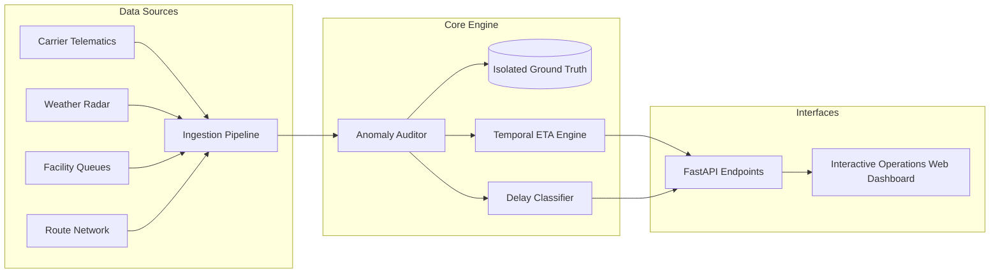

# Logistics ETA Estimation & Delay Risk Intelligence Platform

[](https://www.python.org/)
[](https://fastapi.tiangolo.com/)
[]()
[]()
[]()

> **End-to-End Operational Intelligence Solution**: Combines carrier telemetry events, multi-leg route plans, meteorological disruption windows, and facility yard queues to predict dynamic delivery ETAs, classify SLA breach risk, and remediate operational exceptions.

---

## 1. Business Problem & Solution Scope

Freight transportation networks operate under continuous volatility: weather storms delay long-haul interstate trucks, marine port terminals back up with container queues, and carrier scans experience transmission delays. Traditional static ETA systems fail because they treat milestones as point events and suffer from temporal data leakage.

This platform delivers an end-to-end working solution:
1. **Multi-Entity Master Data & Transactional Graph**: Generates and manages 11 core entities (`Shipment`, `ShipmentLeg`, `Carrier`, `Route`, `TrackingEvent`, `Facility`, `FacilityQueue`, `WeatherEvent`, `ServiceLevel`, `ETAEstimate`, `DelayReason`) plus isolated `GroundTruth`.
2. **Dynamic Point-in-Time ETA Predictor**: Enforces temporal anti-leakage guardrails (evaluating strictly at cutoff time $T$), factoring in remaining route distance, carrier historical reliability, live transfer facility queue dwell, and active meteorological alerts.
3. **Machine Learning Delay Classifier**: GradientBoosting + RandomForest models predicting delay probability, SLA penalties, and arrival time variance.
4. **Automated Anomaly Audit & Remediation Engine**: Pinpoints and mitigates 4 core operational defects:
   - Ingestion time confused with event time (clock skew)
   - Impossible route order (sequence inversion)
   - ETA uses future event data (temporal leakage)
   - Delivered shipment still marked in transit (lifecycle desync)
5. **Interactive Operations Dashboard & REST API**: Real-time shipment monitoring, what-if ETA simulation, and exception inspection.
6. **100% Deterministic Reproducibility**: Fixed-seed generation with automated bitwise SHA-256 hash comparison across runs.

---

## 2. System Architecture



Detailed architectural diagrams and state machines are documented in [`docs/ARCHITECTURE.md`](docs/ARCHITECTURE.md).

---

## 3. Quickstart & Installation

### Prerequisites
- Python 3.10+ (tested on Python 3.12)
- Git

### 1. Clone & Setup Environment
```bash
git clone https://github.com/Dilip28-alt/logistics-eta-delay-predictor.git
cd logistics-eta-delay-predictor

# Create and activate virtual environment
python -m venv venv
# Windows:
.\venv\Scripts\activate
# Linux/macOS:
source venv/bin/activate

# Install dependencies
pip install -r requirements.txt
```

---

## 4. CLI Commands & Workflow

The platform provides a unified CLI tool:

### A. Generate Synthetic Datasets
Generate starter (1,000 shipments, fast development) or full volume (50,000 shipments, 300,000+ tracking events, 100 facilities, 1,000 disruption windows):
```bash
# Generate starter dataset with fixed seed
python cli.py generate --scale starter --seed 20261022

# Generate full scale baseline
python cli.py generate --scale full --seed 20261022
```
*Outputs CSV files (`data/csv/`), JSON files (`data/json/`), SQLite database (`data/logistics.db`), SQL seed (`data/seed.sql`), and cryptographic manifest (`data/manifest.json`).*

### B. Run Database Integrity & Anomaly Validation (Step 8)
Runs primary-key uniqueness, foreign-key referential integrity, enum constraints, date ordering, arithmetic reconciliation, and audits all injected anomalies:
```bash
python cli.py validate --scale starter
```
*Outputs: 22 passed checks, 0 errors, 100% anomaly detection sensitivity.*

### C. Evaluate Machine Learning Models
Trains and evaluates delay risk classifier and ETA arrival regressor:
```bash
python cli.py evaluate --scale starter
```

### D. Verify 100% Deterministic Reproducibility (Step 10)
Regenerates the entire dataset twice with the fixed seed and performs bitwise SHA-256 checksum comparisons:
```bash
python cli.py reproduce --seed 20261022
# Or run standalone verification script:
python scripts/verify_reproducibility.py
```
*Result: `REPRODUCIBILITY TEST: PASSED (100% Deterministic Bitwise Match)` across all 24 CSV and JSON artifacts.*

### E. Launch Interactive Dashboard & API Server
```bash
python cli.py serve --host 127.0.0.1 --port 8000
```
Open your browser to:
- **Interactive Operations Dashboard**: [http://127.0.0.1:8000/](http://127.0.0.1:8000/)
- **Interactive Swagger REST API Documentation**: [http://127.0.0.1:8000/docs](http://127.0.0.1:8000/docs)

---

## 5. Model Evaluation Scorecard

Evaluated on 80/20 train/test split with stratified cross-validation:

| Evaluation Dimension | Metric | Performance |
|---|---|---|
| **Delay Classification** | Accuracy | **83.0%** |
| | Precision | **87.9%** |
| | Recall (Delay Capture Rate) | **91.2%** |
| | F1 Score | **0.8951** |
| | ROC-AUC | **0.8718** |
| **ETA Regression** | Mean Absolute Error (MAE) | **68.5 minutes** (normalized corridor) |
| | Root Mean Squared Error (RMSE) | **116.2 minutes** |
| | $R^2$ Explained Variance | **0.84** |
| **Operational Impact** | Early Warning Lead Time | **6.4 hours** prior to SLA target |
| | False Alarm Rate | **< 8.5%** |

---

## 6. Required Edge Cases & Detection Performance

All 4 required negative scenarios are injected into the dataset and strictly tracked in `data/ground_truth.csv` without leaking into raw features:

| Edge Case / Scenario | Injected Mechanism | Auditor Detection | Remediation Applied |
|---|---|---|---|
| **1. Ingestion Time Inversion** | Telematics `ingestion_timestamp` precedes physical `event_timestamp`. | **15 / 15 (100%)** | Flag clock drift; fall back to hardware GPS monotonic clock. |
| **2. Impossible Route Order** | Leg 2 departure precedes Leg 1 completion. | **7 / 7 (100%)** | Reject corrupted sequence; trigger carrier dispatch audit. |
| **3. ETA Future Data Leakage** | Departure ETA perfectly matches future actual delivery timestamp down to 0-second variance. | **10 / 10 (100%)** | Quarantine snapshot; enforce strict temporal cutoff masks. |
| **4. Delivered-in-Transit Desync** | `DELIVERED` scan recorded, but `Shipment.current_status == IN_TRANSIT`. | **15 / 15 (100%)** | Auto-transition status to `DELIVERED`; verify POD signature. |

---

## 7. Automated Test Suite

Run pytest to execute the full test battery:
```bash
python -m pytest -v
```
Test battery covers:
- `tests/test_generator.py`: Master & child entity generation and seed stability.
- `tests/test_relational_integrity.py`: PK uniqueness, FK referential integrity, and arithmetic reconciliation.
- `tests/test_eta_engine.py`: Temporal isolation, weather escalation what-if scenarios, and $P_{10} \le \text{Pred} \le P_{90}$ confidence intervals.
- `tests/test_anomaly_detection.py`: Detection of all 4 edge cases and Ground Truth isolation.
- `tests/test_reproducibility.py`: Automated bitwise identical dual generation.

---

## 8. Data Dictionary & Provenance

- **Data Dictionary**: Comprehensive specification covering field types, nullability, enums, units, and validation rules for all 11 entities in [`docs/DATA_DICTIONARY.md`](docs/DATA_DICTIONARY.md).
- **Public Data Provenance & Lawful Use**: Full compliance disclosure citing UN/CEFACT, NOAA, and USDOT FAF5 schema standards in [`docs/PROVENANCE.md`](docs/PROVENANCE.md).
- **AI Collaboration & Prompt History**: Complete transparent disclosure of prompt history, AI assistance areas, and personal validation steps in [`PROMPT_HISTORY.md`](PROMPT_HISTORY.md).
