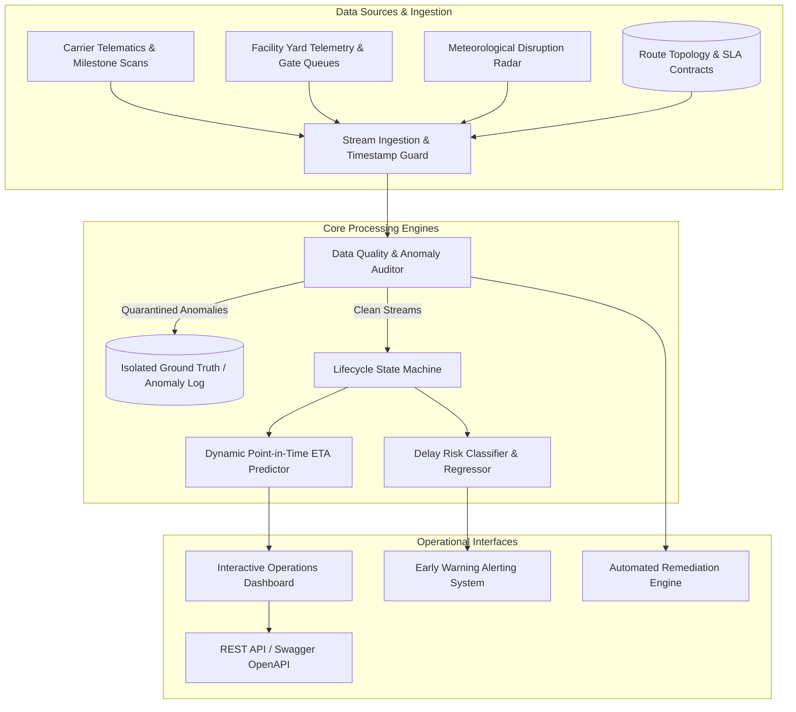

# System Architecture & Technical Design Document

**Project**: Logistics ETA Estimation & Delay Risk Intelligence Platform  
**Target Workflow**: Combine carrier events, route plans, weather disruptions, and facility queues to predict dynamic ETA and surface likely delays.

---

## 1. System Context & Information Flow

The platform ingests streaming milestone scans, static route topology, carrier fleet parameters, real-time facility yard queue telemetry, and regional meteorological alerts.

---

## 2. Primary Actors & Personas

| Actor / Persona | Core Responsibilities | Platform Touchpoint |
|---|---|---|
| **Supplier** | Initiates freight orders, defines pickup readiness and origin SLA. | `/api/shipments` order registration and initial dispatch window. |
| **Planner** | Defines multi-leg routing corridors, carrier lane assignments, and SLA penalty terms. | Route planning matrix, ServiceLevel configurations. |
| **Carrier / Yard Operator** | Reports gate-in, dwell scans, GPS checkpoint pings, and yard queue depth. | Telematics event ingestion stream and facility queue monitors. |
| **Logistics Analyst** | Audits prediction accuracy, calibrates MAE/RMSE benchmarks, inspects anomaly ground truth. | Evaluation Scorecard, Anomaly Audit Reports, Model calibration. |
| **Operations Manager** | Monitors SLA breach alerts, reviews high-risk shipments, executes what-if reroutes. | What-If ETA Simulator, Executive KPI ribbon, Remediation controls. |

---

## 3. Key Design Decisions & Technical Trade-offs

### A. Point-in-Time Temporal Anti-Leakage Isolation
- **Problem**: In naive ETA systems, features extracted at prediction time $T$ accidentally reference future events occurring at $T_{future} > T$ (e.g. downstream delays or actual arrival times), leading to artificially inflated evaluation metrics.
- **Design Choice**: The `ETAPredictor` requires an explicit evaluation cutoff $T_{\text{eval}}$. All tracking scans, queue snapshots, and weather disruptions where timestamp $> T_{\text{eval}}$ are strictly filtered out before feature derivation.

### B. Dual-Timestamp Modeling (Event Time vs Ingestion Time)
- **Problem**: Telematics devices in remote transit corridors frequently buffer messages, transmitting batch scans hours after physical occurrence. Conflating ingestion time with physical event time causes inverted chronologies.
- **Design Choice**: Every `TrackingEvent` records both `event_timestamp` (physical occurrence) and `ingestion_timestamp` (system intake). Anomaly detectors identify backwards skews (`ingestion_ts < event_ts`) and trigger clock-synchronization remediation.

### C. Ground Truth Isolation
- **Problem**: Including ground-truth anomaly tags or actual delivery times within training features causes catastrophic data leakage.
- **Design Choice**: An independent `ground_truth` table (`ground_truth.csv` and `ground_truth.json`) stores ground-truth anomaly flags and true physical delivery values. The ETA inference engine has zero access to this table.

### D. Deterministic Fixed-Seed Synthetic Engine
- **Problem**: Randomized synthetic benchmarks often fail to reproduce identical datasets across developer machines.
- **Design Choice**: Seeded pseudorandom generators (`seed=20261022`) generate identical entities, route graphs, and edge cases. Step 10 automated test proves 100% bitwise SHA-256 match.

---

## 4. Multi-Leg Routing & Delay Mathematical Model

### Expected Arrival Formulation
For a shipment with remaining legs $L = \{l_{\text{current}}, \dots, l_{\text{final}}\}$:

$$\text{ETA}(T_{\text{eval}}) = T_{\text{eval}} + \sum_{l \in L} \left( \frac{\text{Distance}_l}{\text{Speed}_{\text{base}}} \times \left(1 + (1 - \text{Rel}_c) \times \gamma\right) \times W_{r} \right) + \sum_{h \in H} \text{Dwell}_{h}(T_{\text{eval}})$$

Where:
- $\text{Speed}_{\text{base}}$: Baseline mode speed (70 km/h road freight).
- $\text{Rel}_c$: Assigned carrier historical reliability score $\in [0.75, 1.0]$.
- $\gamma$: Reliability impact scale factor (0.7).
- $W_{r}$: Active weather penalty multiplier intersecting route corridor $r$ ($\ge 1.0$).
- $\text{Dwell}_{h}$: Dwell time at intermediate transfer facility $h$, informed by real-time `FacilityQueue` queue depth and processing capacity.

### Confidence Bounds
- $P_{10}$ (Optimistic): $\text{ETA} - \left(20\text{m} + 2.5\text{m} \times \text{Hours}_{\text{rem}}\right)$
- $P_{90}$ (Pessimistic): $\text{ETA} + \left(30\text{m} + 5.0\text{m} \times \text{Hours}_{\text{rem}}\right)$

---

## 5. Labelled Edge Cases & Operational Remediation

| Scenario | Manifestation | Root Cause | Remediation Action |
|---|---|---|---|
| **1. Ingestion Time Inversion** | `ingestion_ts < event_ts` | Telematics clock drift, bad timezone conversion. | Quarantine scan, flag time skew, revert to GPS hardware clock. |
| **2. Impossible Route Order** | Leg $N+1$ departure precedes Leg $N$ arrival. | Waypoint sequence misordered in carrier EDI. | Halt downstream dispatch, trigger supervisor route audit. |
| **3. ETA Future Data Leakage** | Departure ETA matches future actual delivery timestamp down to 0-second variance. | Unmasked feature pipeline leakage in ML feature store. | Invalidate snapshot, enforce temporal masking cutoffs. |
| **4. Delivered-in-Transit Desync** | `DELIVERED` scan recorded, but `Shipment.current_status == IN_TRANSIT`. | Event bus dropped state transition message. | Trigger auto-reconciliation, verify proof-of-delivery, close shipment. |
