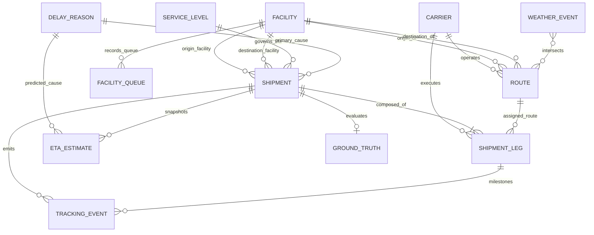
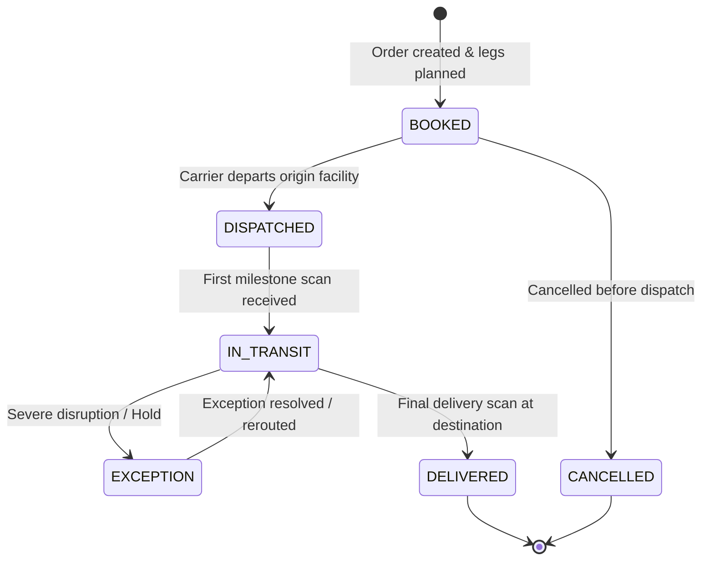
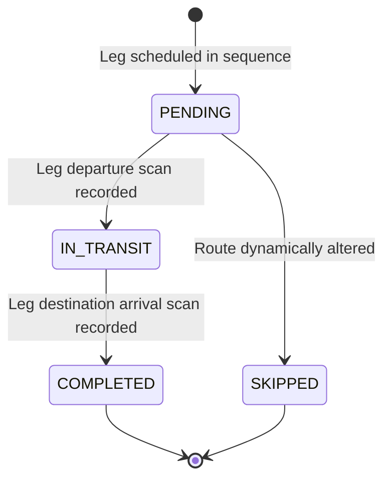

# Data Dictionary & Entity Relationship Specification

**System**: Logistics ETA Estimation & Delay Risk Platform  
**Target Entities**: `Shipment`, `ShipmentLeg`, `Carrier`, `Route`, `TrackingEvent`, `Facility`, `FacilityQueue`, `WeatherEvent`, `ServiceLevel`, `ETAEstimate`, `DelayReason`, `GroundTruth`  
**Temporal Reference**: UTC Timestamps (ISO-8601 `YYYY-MM-DDTHH:MM:SSZ`)  
**ID Nomenclature**:
- Shipment: `SHP-2026-000001`
- ShipmentLeg: `LEG-SHP-2026-000001-01`
- TrackingEvent: `EVT-SHP-2026-000001-000001`
- ETAEstimate: `ETA-SHP-2026-000001-20261022T140000Z`
- DelayReason: `DLY-2026-000001` (Taxonomy: `DLY-WTH-01`, `DLY-FAC-01`, etc.)
- Carrier: `CRR-001` to `CRR-020`
- Facility: `FAC-001` to `FAC-100`
- Route: `RTE-0001` to `RTE-0500`
- FacilityQueue: `QUE-FAC-001-20261022T080000Z`
- WeatherEvent: `WTH-2026-000001`

---

## 1. Entity-Relationship Overview

### Cardinality and Relationship Matrix
| Parent Entity | Child Entity | Cardinality | Join Keys | Description |
|---|---|---|---|---|
| `Carrier` | `Route` | 1:N | `carrier_id` | Carrier can serve multiple standard corridors. |
| `Facility` | `Route` | 1:N | `origin_facility_id` / `dest_facility_id` | Facilities are network nodes. |
| `Facility` | `FacilityQueue` | 1:N | `facility_id` | Dwell and gate congestion snapshots over time. |
| `ServiceLevel` | `Shipment` | 1:N | `service_level_id` | Guaranteed transit hours and penalty thresholds. |
| `Shipment` | `ShipmentLeg` | 1:N | `shipment_id` | Multi-leg route breakdown (1 to 3 legs). |
| `ShipmentLeg` | `TrackingEvent`| 1:N | `leg_id` | Milestone events occurring on a specific leg. |
| `Shipment` | `TrackingEvent`| 1:N | `shipment_id` | Lifecycle events for shipment. |
| `Shipment` | `ETAEstimate` | 1:N | `shipment_id` | Point-in-time ETA revision snapshots. |
| `DelayReason` | `Shipment` | 1:N | `delay_reason_id` | Root-cause classification for delayed shipments. |
| `DelayReason` | `ETAEstimate` | 1:N | `predicted_delay_reason_id` | Predicted primary root cause at snapshot time. |
| `Shipment` | `GroundTruth` | 1:1 | `entity_id` | Ground truth anomaly flag, actual delay, and target. |

---

## 2. Granular Data Dictionary

### Table 1: `Carrier`
Master table containing freight carriers, operational modes, and historical baseline reliability.

| Field Name | Type | Required | Allowed Values / Format | Units | Uniqueness | Validation Rule |
|---|---|---|---|---|---|---|
| `carrier_id` | VARCHAR(16) | Yes | `CRR-[0-9]{3}` | None | PK, Unique | Matches pattern `^CRR-\d{3}$`. |
| `carrier_name` | VARCHAR(100) | Yes | Non-empty string | None | Non-unique | Length between 3 and 100 characters. |
| `transport_mode` | VARCHAR(20) | Yes | `ROAD`, `RAIL`, `AIR`, `OCEAN` | None | Non-unique | Must be valid mode enum. |
| `reliability_score` | FLOAT | Yes | `0.50` to `1.00` | Ratio | Non-unique | Float in $[0.50, 1.00]$. |
| `operating_calendar` | VARCHAR(20) | Yes | `24x7`, `WEEKDAYS_ONLY`, `EXTENDED_HOURS` | None | Non-unique | Valid operational schedule string. |
| `contact_email` | VARCHAR(120) | Yes | Valid email string | None | Non-unique | Contains `@` and valid domain. |
| `created_at` | TIMESTAMP | Yes | ISO-8601 UTC | UTC | Non-unique | Valid timestamp $\le$ current time. |

---

### Table 2: `Facility`
Master logistics network nodes representing marine ports, railheads, cross-docks, and distribution hubs.

| Field Name | Type | Required | Allowed Values / Format | Units | Uniqueness | Validation Rule |
|---|---|---|---|---|---|---|
| `facility_id` | VARCHAR(16) | Yes | `FAC-[0-9]{3}` | None | PK, Unique | Matches `^FAC-\d{3}$`. |
| `facility_name` | VARCHAR(120) | Yes | Non-empty string | None | Unique | Alphanumeric name. |
| `facility_type` | VARCHAR(30) | Yes | `PORT`, `CROSS_DOCK`, `DISTRIBUTION_CENTER`, `FULFILLMENT_CENTER` | None | Non-unique | Valid facility type enum. |
| `region` | VARCHAR(30) | Yes | `MIDWEST`, `NORTHEAST`, `SOUTHEAST`, `SOUTHWEST`, `WEST_COAST` | None | Non-unique | Valid geographic territory. |
| `latitude` | FLOAT | Yes | `24.0` to `50.0` | Degrees | Non-unique | Valid North American latitude. |
| `longitude` | FLOAT | Yes | `-125.0` to `-66.0` | Degrees | Non-unique | Valid North American longitude. |
| `capacity_trucks_per_hr`| INTEGER | Yes | `10` to `200` | Trucks/Hour | Non-unique | Integer $> 0$. |
| `nominal_dwell_hours` | FLOAT | Yes | `0.5` to `12.0` | Hours | Non-unique | Nominal staging/dwell duration. |
| `operating_calendar` | VARCHAR(20) | Yes | `24x7`, `WEEKDAYS_ONLY`, `TWO_SHIFTS` | None | Non-unique | Valid operational calendar. |
| `created_at` | TIMESTAMP | Yes | ISO-8601 UTC | UTC | Non-unique | Valid timestamp. |

---

### Table 3: `Route`
Corridors connecting origin and destination facility pairs with baseline distances and standard transit durations.

| Field Name | Type | Required | Allowed Values / Format | Units | Uniqueness | Validation Rule |
|---|---|---|---|---|---|---|
| `route_id` | VARCHAR(16) | Yes | `RTE-[0-9]{4}` | None | PK, Unique | Matches `^RTE-\d{4}$`. |
| `origin_facility_id`| VARCHAR(16) | Yes | `FAC-[0-9]{3}` | None | Non-unique | FK -> `Facility.facility_id`. |
| `destination_facility_id`| VARCHAR(16) | Yes | `FAC-[0-9]{3}` | None | Non-unique | FK -> `Facility.facility_id`; Must $\ne$ `origin_facility_id`. |
| `primary_carrier_id`| VARCHAR(16) | Yes | `CRR-[0-9]{3}` | None | Non-unique | FK -> `Carrier.carrier_id`. |
| `transport_mode` | VARCHAR(20) | Yes | `ROAD`, `RAIL`, `AIR`, `OCEAN` | None | Non-unique | Must match primary carrier mode. |
| `distance_km` | FLOAT | Yes | `50.0` to `5000.0` | Kilometers | Non-unique | Positive float calculated from haversine + route circuity. |
| `standard_transit_hours` | FLOAT | Yes | `1.0` to `120.0` | Hours | Non-unique | Derived from distance and speed limit. |
| `is_toll_road` | BOOLEAN | Yes | `TRUE`, `FALSE` | None | Non-unique | Boolean flag. |
| `created_at` | TIMESTAMP | Yes | ISO-8601 UTC | UTC | Non-unique | Valid timestamp. |

---

### Table 4: `ServiceLevel`
SLA policy governing maximum allowable transit hours, buffer tolerances, and delay penalties.

| Field Name | Type | Required | Allowed Values / Format | Units | Uniqueness | Validation Rule |
|---|---|---|---|---|---|---|
| `service_level_id` | VARCHAR(16) | Yes | `SL-[A-Z]{3,4}` | None | PK, Unique | E.g. `SL-CRIT`, `SL-EXP`, `SL-STD`, `SL-ECO`. |
| `service_level_name`| VARCHAR(40) | Yes | `CRITICAL_FREIGHT`, `EXPRESS`, `STANDARD`, `ECONOMY` | None | Unique | Descriptive SLA tier name. |
| `max_delay_tolerance_mins` | INTEGER | Yes | `0` to `720` | Minutes | Non-unique | SLA on-time grace period (e.g. 15m, 60m, 120m, 240m). |
| `target_on_time_pct` | FLOAT | Yes | `90.0` to `99.9` | Percent | Non-unique | Required historical compliance rate. |
| `penalty_per_hour_delayed` | FLOAT | Yes | `50.0` to `1000.0` | USD | Non-unique | Contractual financial impact per hour of delay. |
| `description` | TEXT | No | Free text | None | Non-unique | Contract summary. |

---

### Table 5: `DelayReason`
Taxonomy for root-cause attribution of transit and facility delays.

| Field Name | Type | Required | Allowed Values / Format | Units | Uniqueness | Validation Rule |
|---|---|---|---|---|---|---|
| `delay_reason_id` | VARCHAR(16) | Yes | `DLY-2026-[0-9]{6}` or `DLY-[A-Z]{3}-[0-9]{2}` | None | PK, Unique | Matches `^DLY-.*$`. |
| `category` | VARCHAR(40) | Yes | `WEATHER`, `FACILITY_CONGESTION`, `CARRIER_MECHANICAL`, `ROUTE_BLOCKAGE`, `CUSTOMS_INSPECTION`, `OPERATIONAL_MISMATCH` | None | Non-unique | Valid delay taxonomy category. |
| `sub_reason` | VARCHAR(80) | Yes | Non-empty string | None | Non-unique | E.g. `BLIZZARD_ROAD_CLOSURE`, `GATE_BACKLOG`. |
| `severity_tier` | VARCHAR(20) | Yes | `MINOR`, `MODERATE`, `SEVERE`, `CATASTROPHIC` | None | Non-unique | Impact classification. |
| `is_carrier_fault` | BOOLEAN | Yes | `TRUE`, `FALSE` | None | Non-unique | For liability and insurance attribution. |

---

### Table 6: `Shipment`
Master transaction record for an end-to-end freight consignment.

| Field Name | Type | Required | Allowed Values / Format | Units | Uniqueness | Validation Rule |
|---|---|---|---|---|---|---|
| `shipment_id` | VARCHAR(24) | Yes | `SHP-2026-[0-9]{6}` | None | PK, Unique | Immutable zero-padded ID. |
| `origin_facility_id` | VARCHAR(16) | Yes | `FAC-[0-9]{3}` | None | Non-unique | FK -> `Facility.facility_id`. |
| `destination_facility_id`| VARCHAR(16) | Yes | `FAC-[0-9]{3}` | None | Non-unique | FK -> `Facility.facility_id`; Must $\ne$ `origin_facility_id`. |
| `service_level_id` | VARCHAR(16) | Yes | `SL-[A-Z]{3,4}` | None | Non-unique | FK -> `ServiceLevel.service_level_id`. |
| `total_legs` | INTEGER | Yes | `1`, `2`, `3` | Count | Non-unique | Equal to count of child `ShipmentLeg` rows. |
| `planned_departure_ts` | TIMESTAMP | Yes | ISO-8601 UTC | UTC | Non-unique | Start of planned execution window. |
| `planned_delivery_ts` | TIMESTAMP | Yes | ISO-8601 UTC | UTC | Non-unique | Must be $>$ `planned_departure_ts`. |
| `actual_departure_ts` | TIMESTAMP | No | ISO-8601 UTC | UTC | Non-unique | Set once dispatched. |
| `actual_delivery_ts` | TIMESTAMP | No | ISO-8601 UTC | UTC | Non-unique | Set once delivered; must be $>$ `actual_departure_ts`. |
| `current_status` | VARCHAR(30) | Yes | `BOOKED`, `DISPATCHED`, `IN_TRANSIT`, `DELIVERED`, `EXCEPTION`, `CANCELLED` | None | Non-unique | Valid lifecycle state. |
| `total_weight_kg` | FLOAT | Yes | `100.0` to `25000.0` | Kilograms | Non-unique | Positive cargo weight. |
| `cargo_value_usd` | FLOAT | Yes | `500.0` to `500000.0`| USD | Non-unique | Insured shipment value. |
| `final_delay_minutes` | INTEGER | No | `0` to `10000` | Minutes | Non-unique | Derived: `max(0, (actual_delivery_ts - planned_delivery_ts).total_seconds() / 60)`. |
| `is_delayed` | BOOLEAN | Yes | `TRUE`, `FALSE` | None | Non-unique | Derived: `final_delay_minutes > max_delay_tolerance_mins`. |
| `primary_delay_reason_id`| VARCHAR(16) | No | `DLY-.*` | None | Non-unique | FK -> `DelayReason.delay_reason_id`, set if delayed. |
| `created_at` | TIMESTAMP | Yes | ISO-8601 UTC | UTC | Non-unique | Audit record creation timestamp. |

---

### Table 7: `ShipmentLeg`
Multi-leg breakdown for routing through intermediate cross-docks and transfers.

| Field Name | Type | Required | Allowed Values / Format | Units | Uniqueness | Validation Rule |
|---|---|---|---|---|---|---|
| `leg_id` | VARCHAR(32) | Yes | `LEG-SHP-2026-[0-9]{6}-[0-9]{2}` | None | PK, Unique | E.g. `LEG-SHP-2026-000001-01`. |
| `shipment_id` | VARCHAR(24) | Yes | `SHP-2026-[0-9]{6}` | None | Non-unique | FK -> `Shipment.shipment_id`. |
| `leg_sequence` | INTEGER | Yes | `1`, `2`, `3` | Index | Non-unique | 1-indexed contiguous order. |
| `origin_facility_id` | VARCHAR(16) | Yes | `FAC-[0-9]{3}` | None | Non-unique | FK -> `Facility.facility_id`. |
| `destination_facility_id`| VARCHAR(16) | Yes | `FAC-[0-9]{3}` | None | Non-unique | FK -> `Facility.facility_id`. |
| `carrier_id` | VARCHAR(16) | Yes | `CRR-[0-9]{3}` | None | Non-unique | FK -> `Carrier.carrier_id`. |
| `route_id` | VARCHAR(16) | Yes | `RTE-[0-9]{4}` | None | Non-unique | FK -> `Route.route_id`. |
| `planned_leg_start_ts` | TIMESTAMP | Yes | ISO-8601 UTC | UTC | Non-unique | Scheduled leg start. |
| `planned_leg_end_ts` | TIMESTAMP | Yes | ISO-8601 UTC | UTC | Non-unique | Scheduled leg completion $>$ start. |
| `actual_leg_start_ts` | TIMESTAMP | No | ISO-8601 UTC | UTC | Non-unique | Actual start milestone. |
| `actual_leg_end_ts` | TIMESTAMP | No | ISO-8601 UTC | UTC | Non-unique | Actual end milestone $>$ actual start. |
| `leg_distance_km` | FLOAT | Yes | `20.0` to `4000.0` | Kilometers | Non-unique | Planned route length. |
| `leg_status` | VARCHAR(20) | Yes | `PENDING`, `IN_TRANSIT`, `COMPLETED`, `SKIPPED` | None | Non-unique | Leg lifecycle status. |

---

### Table 8: `TrackingEvent`
Milestone and telemetry scans emitted by carriers, telematics, and facility RFID gates.

| Field Name | Type | Required | Allowed Values / Format | Units | Uniqueness | Validation Rule |
|---|---|---|---|---|---|---|
| `event_id` | VARCHAR(36) | Yes | `EVT-SHP-2026-[0-9]{6}-[0-9]{6}` | None | PK, Unique | E.g. `EVT-SHP-2026-000001-000001`. |
| `shipment_id` | VARCHAR(24) | Yes | `SHP-2026-[0-9]{6}` | None | Non-unique | FK -> `Shipment.shipment_id`. |
| `leg_id` | VARCHAR(32) | No | `LEG-SHP-.*` | None | Non-unique | FK -> `ShipmentLeg.leg_id`. |
| `event_sequence` | INTEGER | Yes | `1` to `50` | Index | Non-unique | Contiguous sequence for shipment. |
| `event_type` | VARCHAR(40) | Yes | `SHIPMENT_CREATED`, `CARRIER_ASSIGNED`, `GATE_IN`, `LOADING_STARTED`, `DEPARTURE`, `IN_TRANSIT_CHECKPOINT`, `GATE_OUT`, `TRANSFER_ARRIVAL`, `TRANSFER_DEPARTURE`, `OUT_FOR_DELIVERY`, `DELIVERED`, `EXCEPTION_HOLD` | None | Non-unique | Allowed lifecycle scan codes. |
| `event_timestamp` | TIMESTAMP | Yes | ISO-8601 UTC | UTC | Non-unique | Physical time event occurred in the field. |
| `ingestion_timestamp`| TIMESTAMP | Yes | ISO-8601 UTC | UTC | Non-unique | System time event was recorded by EDI/API; Normally $\ge$ `event_timestamp`. |
| `facility_id` | VARCHAR(16) | No | `FAC-[0-9]{3}` | None | Non-unique | FK -> `Facility.facility_id` (nullable if in-transit GPS). |
| `latitude` | FLOAT | No | `24.0` to `50.0` | Degrees | Non-unique | Latitude coordinate. |
| `longitude` | FLOAT | No | `-125.0` to `-66.0` | Degrees | Non-unique | Longitude coordinate. |
| `status_code` | VARCHAR(20) | Yes | `SCAN_OK`, `LATE_SCAN`, `OFF_ROUTE`, `EXCEPTION` | None | Non-unique | Sensor status. |
| `notes` | TEXT | No | Free text | None | Non-unique | Remarks from driver/facility. |

---

### Table 9: `FacilityQueue`
Periodic gate and yard dwell telemetry capturing facility bottlenecks and congestion spikes.

| Field Name | Type | Required | Allowed Values / Format | Units | Uniqueness | Validation Rule |
|---|---|---|---|---|---|---|
| `queue_id` | VARCHAR(36) | Yes | `QUE-FAC-[0-9]{3}-[0-9]{8}T[0-9]{6}Z` | None | PK, Unique | Formatted queue snapshot key. |
| `facility_id` | VARCHAR(16) | Yes | `FAC-[0-9]{3}` | None | Non-unique | FK -> `Facility.facility_id`. |
| `snapshot_ts` | TIMESTAMP | Yes | ISO-8601 UTC | UTC | Non-unique | Time of sensor queue observation. |
| `queue_depth_trucks`| INTEGER | Yes | `0` to `300` | Trucks | Non-unique | Non-negative integer. |
| `avg_dwell_hours` | FLOAT | Yes | `0.2` to `24.0` | Hours | Non-unique | Average processing wait time. |
| `active_berths` | INTEGER | Yes | `1` to `50` | Berths | Non-unique | Operational loading docks active. |
| `inflow_rate_per_hr` | FLOAT | Yes | `0.0` to `100.0` | Trucks/Hr | Non-unique | Truck arrivals per hour. |
| `outflow_rate_per_hr`| FLOAT | Yes | `0.0` to `100.0` | Trucks/Hr | Non-unique | Processed departures per hour. |
| `congestion_level` | VARCHAR(20) | Yes | `NORMAL`, `MODERATE`, `SEVERE`, `GRIDLOCK` | None | Non-unique | Enum based on queue depth / capacity. |

---

### Table 10: `WeatherEvent`
Atmospheric disruptions intersecting transport corridors and driving speed reductions or route holds.

| Field Name | Type | Required | Allowed Values / Format | Units | Uniqueness | Validation Rule |
|---|---|---|---|---|---|---|
| `weather_id` | VARCHAR(24) | Yes | `WTH-2026-[0-9]{6}` | None | PK, Unique | Matches `^WTH-2026-\d{6}$`. |
| `region` | VARCHAR(30) | Yes | `MIDWEST`, `NORTHEAST`, `SOUTHEAST`, `SOUTHWEST`, `WEST_COAST` | None | Non-unique | Geographic corridor. |
| `event_type` | VARCHAR(30) | Yes | `BLIZZARD`, `HEAVY_SNOW`, `SEVERE_THUNDERSTORM`, `FLOODING`, `HIGH_WINDS`, `DENSE_FOG` | None | Non-unique | Weather classification. |
| `severity` | VARCHAR(20) | Yes | `MODERATE`, `SEVERE`, `EXTREME` | None | Non-unique | Disruption severity tier. |
| `start_ts` | TIMESTAMP | Yes | ISO-8601 UTC | UTC | Non-unique | Disruption start time. |
| `end_ts` | TIMESTAMP | Yes | ISO-8601 UTC | UTC | Non-unique | Disruption end time $>$ start time. |
| `delay_multiplier` | FLOAT | Yes | `1.15` to `3.00` | Factor | Non-unique | Speed penalty factor applied to standard transit time. |
| `radius_km` | FLOAT | Yes | `50.0` to `800.0` | Kilometers | Non-unique | Geographic footprint. |
| `center_lat` | FLOAT | Yes | `24.0` to `50.0` | Degrees | Non-unique | Center coordinate. |
| `center_lon` | FLOAT | Yes | `-125.0` to `-66.0` | Degrees | Non-unique | Center coordinate. |

---

### Table 11: `ETAEstimate`
Immutable temporal prediction snapshots generated at defined evaluation points throughout transit.

| Field Name | Type | Required | Allowed Values / Format | Units | Uniqueness | Validation Rule |
|---|---|---|---|---|---|---|
| `eta_id` | VARCHAR(48) | Yes | `ETA-SHP-2026-[0-9]{6}-[0-9]{8}T[0-9]{6}Z` | None | PK, Unique | Unique snapshot identifier. |
| `shipment_id` | VARCHAR(24) | Yes | `SHP-2026-[0-9]{6}` | None | Non-unique | FK -> `Shipment.shipment_id`. |
| `prediction_ts` | TIMESTAMP | Yes | ISO-8601 UTC | UTC | Non-unique | Cut-off timestamp: Only events $\le$ `prediction_ts` are visible. |
| `current_leg_sequence` | INTEGER | Yes | `1`, `2`, `3` | Index | Non-unique | Current active leg at prediction time. |
| `elapsed_transit_hours` | FLOAT | Yes | $\ge 0.0$ | Hours | Non-unique | Transit time consumed up to `prediction_ts`. |
| `remaining_distance_km`| FLOAT | Yes | $\ge 0.0$ | Kilometers | Non-unique | Distance remaining to final destination. |
| `predicted_delivery_ts`| TIMESTAMP | Yes | ISO-8601 UTC | UTC | Non-unique | Point estimate: `prediction_ts` + remaining hours. |
| `confidence_p10_ts` | TIMESTAMP | Yes | ISO-8601 UTC | UTC | Non-unique | 10th percentile optimistic arrival estimate. |
| `confidence_p90_ts` | TIMESTAMP | Yes | ISO-8601 UTC | UTC | Non-unique | 90th percentile pessimistic arrival estimate. |
| `predicted_delay_minutes`| INTEGER | Yes | $\ge 0$ | Minutes | Non-unique | Derived: `max(0, (predicted_delivery_ts - planned_delivery_ts).total_seconds() / 60)`. |
| `delay_risk_level` | VARCHAR(20) | Yes | `LOW`, `MEDIUM`, `HIGH`, `CRITICAL` | None | Non-unique | `LOW` (<15m), `MEDIUM` (15-60m), `HIGH` (60-240m), `CRITICAL` (>240m or SLA breach). |
| `predicted_delay_reason_id`| VARCHAR(16)| No | `DLY-.*` | None | Non-unique | FK -> `DelayReason.delay_reason_id`. |
| `model_version` | VARCHAR(20) | Yes | E.g. `v1.2.0-hybrid` | None | Non-unique | Algorithm tracking version. |
| `features_snapshot_json`| TEXT | Yes | Valid JSON string | None | Non-unique | Explainability payload containing queue, weather, and carrier factor values. |

---

### Table 12: `GroundTruth` (Isolated Anomaly & Evaluation Truth)
Separate ground truth table for anomaly evaluation, metric computation, and model auditing. **Never leaked into feature vectors during real-time ETA inference.**

| Field Name | Type | Required | Allowed Values / Format | Units | Uniqueness | Validation Rule |
|---|---|---|---|---|---|---|
| `entity_id` | VARCHAR(48) | Yes | Matches target entity PK | None | PK, Unique | E.g. `SHP-2026-000001` or `EVT-...`. |
| `entity_type` | VARCHAR(24) | Yes | `SHIPMENT`, `TRACKING_EVENT`, `ETA_ESTIMATE` | None | Non-unique | Entity classification. |
| `issue_type` | VARCHAR(40) | Yes | `NORMAL`, `INGESTION_TIME_CONFUSION`, `IMPOSSIBLE_ROUTE_ORDER`, `ETA_FUTURE_DATA_LEAKAGE`, `DELIVERED_STILL_IN_TRANSIT` | None | Non-unique | Anomaly classification. |
| `is_anomaly` | BOOLEAN | Yes | `TRUE`, `FALSE` | None | Non-unique | Binary flag for anomaly detection evaluation. |
| `expected_decision` | VARCHAR(40) | Yes | `APPROVE_TRANSIT`, `FLAG_INGESTION_DRIFT`, `REJECT_ROUTE_SEQUENCE`, `FLAG_DATA_LEAKAGE`, `FORCE_DELIVERY_SYNC` | None | Non-unique | Expected operational decision/action. |
| `ground_truth_delivery_ts` | TIMESTAMP | No | ISO-8601 UTC | UTC | Non-unique | True physical delivery time. |
| `ground_truth_delay_mins` | INTEGER | No | $\ge 0$ | Minutes | Non-unique | True final delay in minutes. |
| `ground_truth_delay_category` | VARCHAR(40) | No | Taxonomy category | None | Non-unique | True primary root cause. |
| `anomaly_details` | TEXT | No | Free text / JSON | None | Non-unique | Description of injected defect and remediation. |

---

## 3. Lifecycle State Machines

### Shipment Lifecycle State Machine

### ShipmentLeg Lifecycle State Machine

